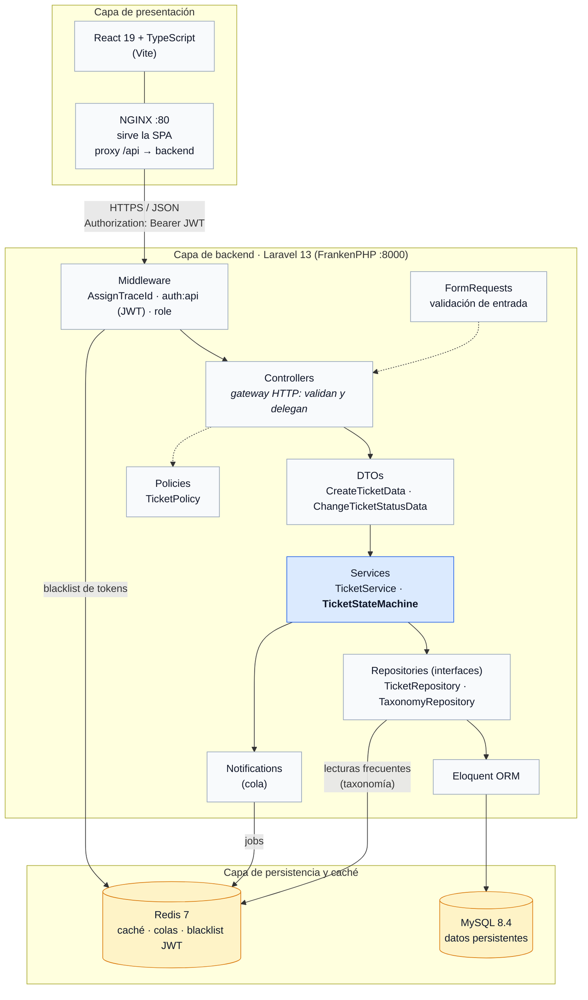
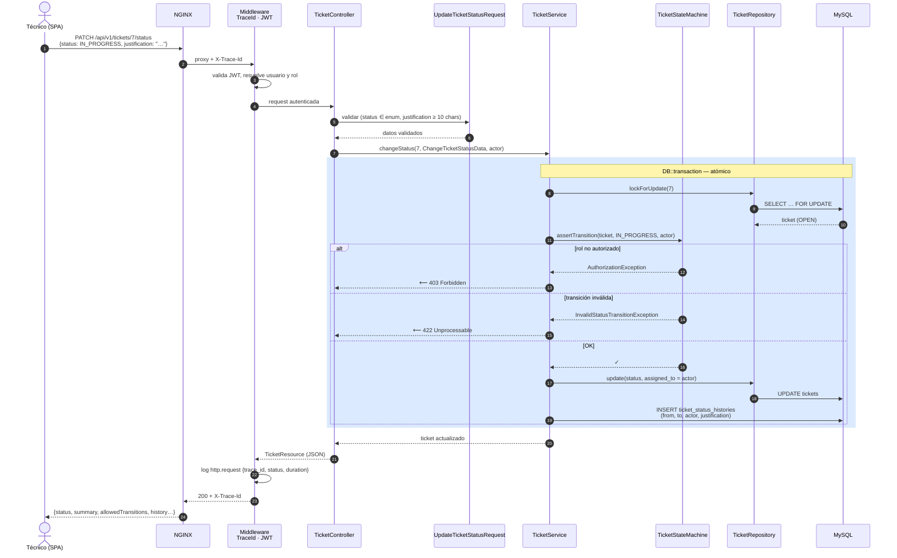
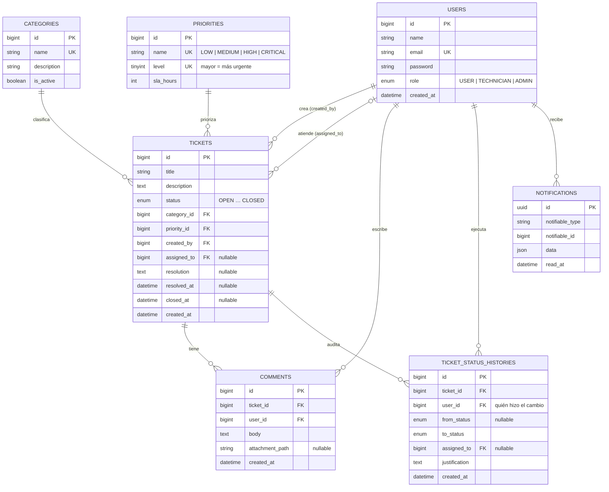
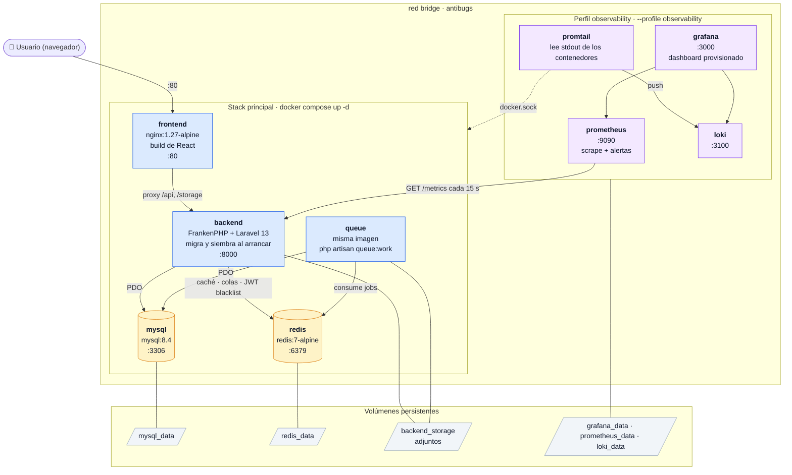
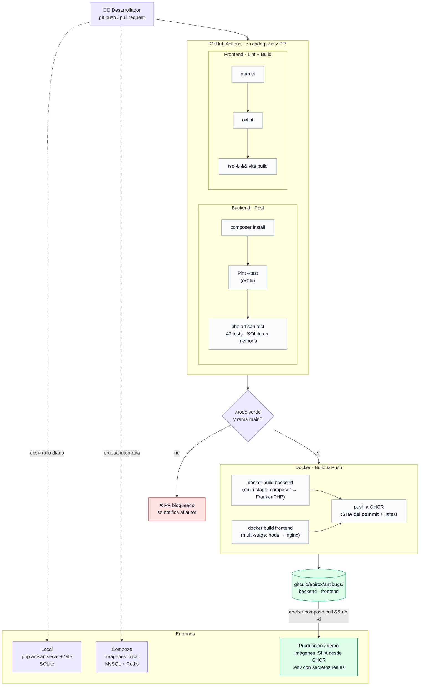
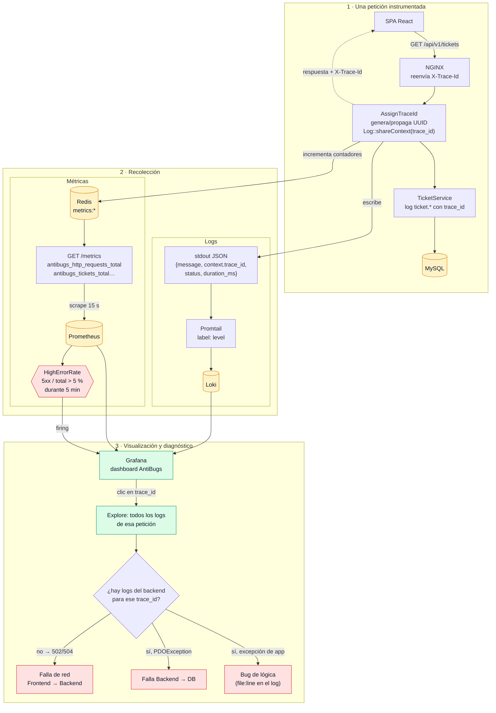

# 6 · Diagramas

Diagramas en formato [Mermaid](https://mermaid.js.org/): GitHub los renderiza automáticamente en este archivo. Las versiones en PNG para pegar en el documento o las diapositivas están en [`diagramas/`](./diagramas/).

| # | Diagrama | Sección del TP donde va |
|---|---|---|
| 1 | [Arquitectura por capas y componentes](#1-arquitectura-por-capas-y-componentes) | 2 · Arquitectura |
| 2 | [Secuencia: cambio de estado de un ticket](#2-secuencia-cambio-de-estado-de-un-ticket) | 2 · Arquitectura / 4 · Backend |
| 3 | [Máquina de estados del ticket](#3-máquina-de-estados-del-ticket) | 2 · Arquitectura (patrón State Machine) |
| 4 | [Modelo de datos (ER)](#4-modelo-de-datos-er) | 4 · Backend, POO y APIs |
| 5 | [Contenedores Docker Compose](#5-contenedores-docker-compose) | 6 · Docker, DevOps y despliegue |
| 6 | [Pipeline CI/CD](#6-pipeline-cicd) | 6 · Docker, DevOps y despliegue |
| 7 | [Flujo de observabilidad y trace_id](#7-flujo-de-observabilidad-y-trace_id) | 7 · Observabilidad |

---

## 1 · Arquitectura por capas y componentes

**Lectura:** el frontend nunca contiene reglas de negocio; el controlador sólo valida y delega; la lógica (transiciones, permisos, transaccionalidad) vive en la capa de servicios y es independiente de cómo llega la petición y de dónde se guarda el dato.

---

## 2 · Secuencia: cambio de estado de un ticket

`PATCH /api/v1/tickets/7/status` — el técnico toma un ticket abierto.

---

## 3 · Máquina de estados del ticket

```mermaid
stateDiagram-v2
    direction LR

    [*] --> OPEN : usuario crea el ticket<br/>(CU-U01)

    OPEN --> ASSIGNED : técnico/admin asigna
    OPEN --> IN_PROGRESS : técnico toma el caso
    ASSIGNED --> IN_PROGRESS : técnico comienza
    ASSIGNED --> OPEN : devolver a la cola
    IN_PROGRESS --> PENDING_INFO : falta información del usuario
    PENDING_INFO --> IN_PROGRESS : usuario responde
    IN_PROGRESS --> ASSIGNED : escalar a otro técnico
    IN_PROGRESS --> RESOLVED : técnico registra la solución<br/>(requiere resolution + técnico asignado)
    RESOLVED --> CLOSED : <b>creador</b> confirma (o admin)
    RESOLVED --> IN_PROGRESS : usuario rechaza la solución
    CLOSED --> [*]

    note right of OPEN
        Toda transición exige
        <b>justificación escrita</b>
        y queda en el historial.
    end note

    note right of CLOSED
        Estado final:
        sin transiciones de salida.
    end note

    classDef trabajo fill:#fef3c7,stroke:#d97706
    classDef fin fill:#dcfce7,stroke:#059669
    classDef cerrado fill:#e5e7eb,stroke:#374151
    class ASSIGNED,IN_PROGRESS,PENDING_INFO trabajo
    class RESOLVED fin
    class CLOSED cerrado
```

| Transición hacia | Roles autorizados |
|---|---|
| OPEN, ASSIGNED, IN_PROGRESS, PENDING_INFO, RESOLVED | TECHNICIAN, ADMIN |
| CLOSED | USER (sólo el creador del ticket), ADMIN |

---

## 4 · Modelo de datos (ER)

---

## 5 · Contenedores Docker Compose

**Orden de arranque (orquestación):** `mysql` y `redis` → *healthcheck* OK → `backend` (el *entrypoint* espera los puertos, ejecuta `migrate` y `db:seed`) → *healthcheck* `/up` OK → `frontend` y `queue`. Cada servicio declara `depends_on: condition: service_healthy`.

---

## 6 · Pipeline CI/CD

**Inmutabilidad:** cada build genera una imagen etiquetada con el SHA del commit; lo que pasó por pruebas es exactamente lo que se despliega. Un *rollback* es volver a desplegar el SHA anterior.

---

## 7 · Flujo de observabilidad y trace_id

