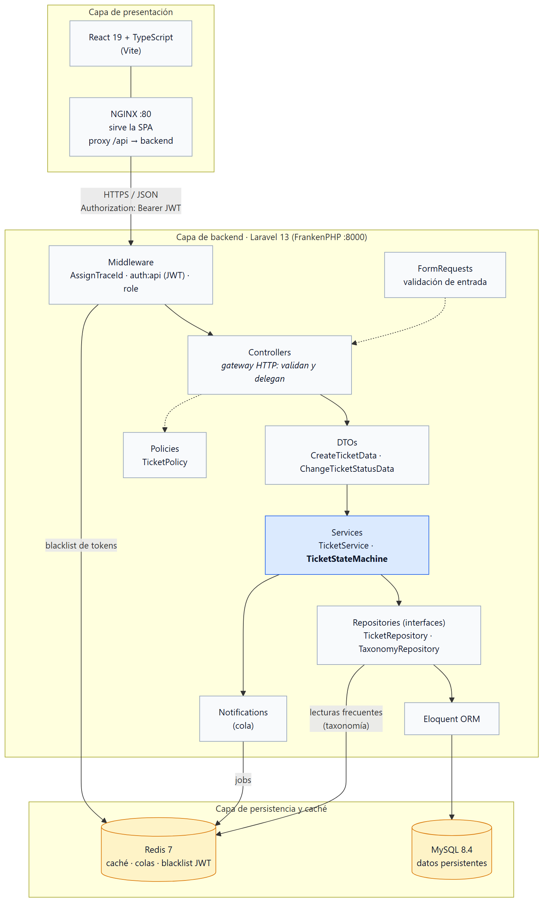
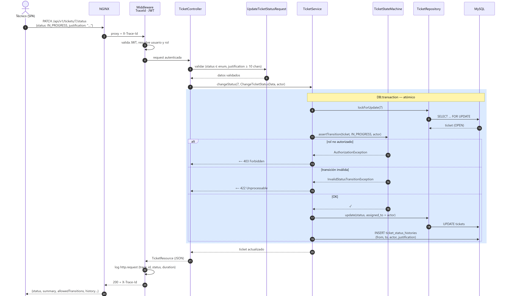
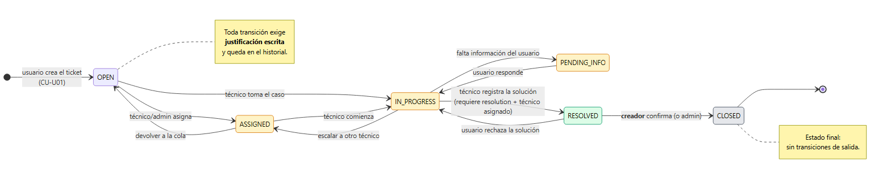
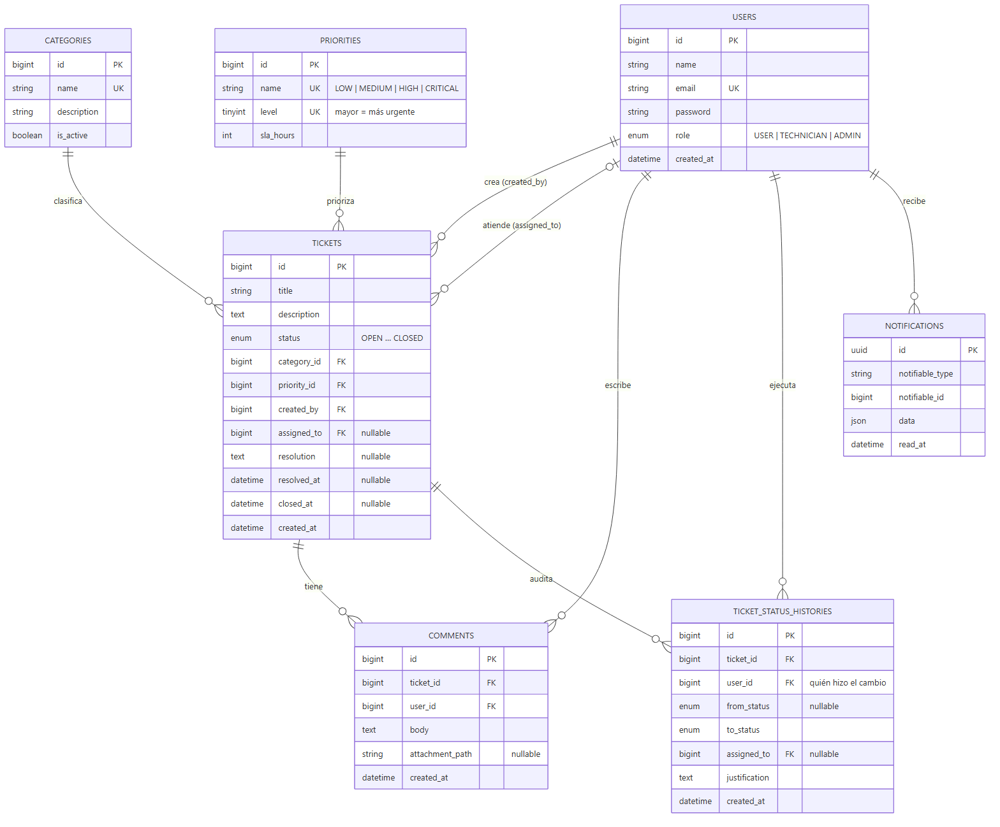
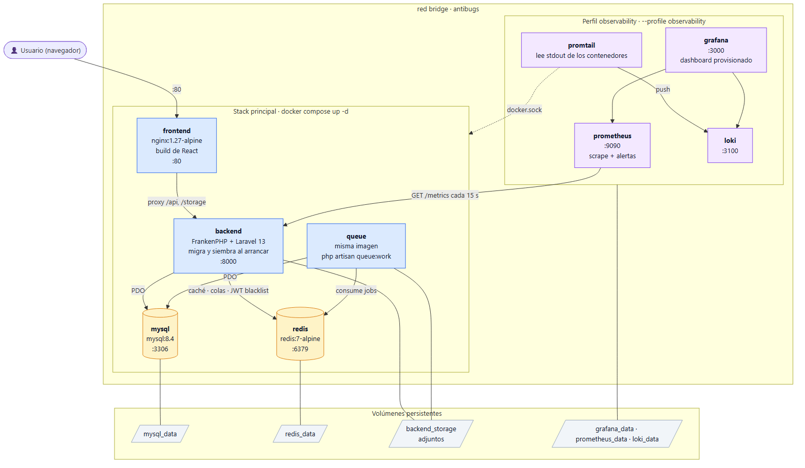
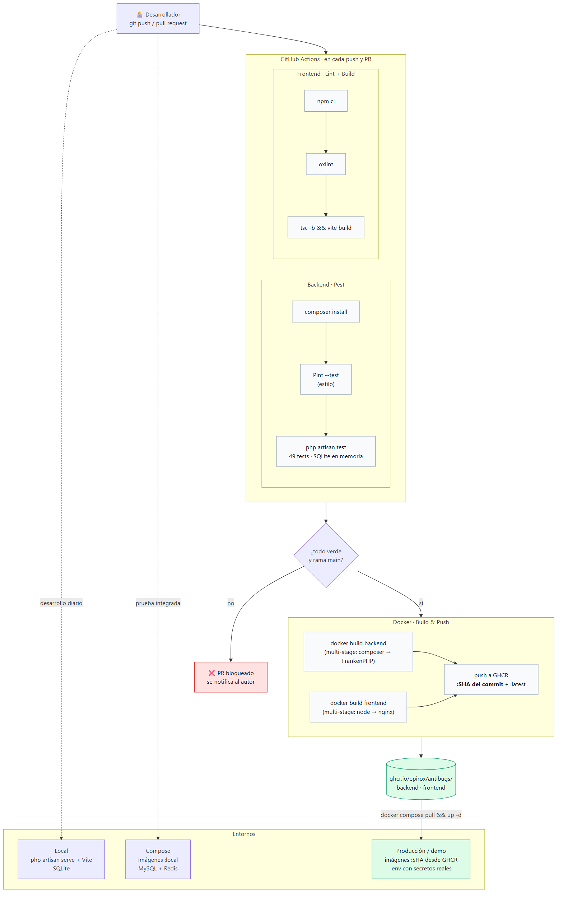
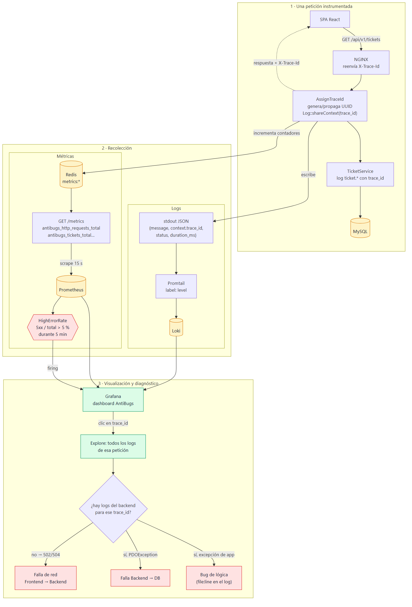

# Diagramas (PNG)

Imágenes listas para pegar en el documento o las diapositivas. La fuente es [`../06-diagramas.md`](../06-diagramas.md) (Mermaid); para regenerarlas después de editar: `powershell -File render.ps1`.

| Archivo | Diagrama | Sección del TP |
|---|---|---|
|  | **01 · Arquitectura por capas y componentes** | 2 · Arquitectura |
|  | **02 · Secuencia: `PATCH /tickets/{id}/status`** (transacción, State Machine, 403 / 422) | 2 · Arquitectura · 4 · Backend |
|  | **03 · Máquina de estados del ticket** | 2 · Arquitectura |
|  | **04 · Modelo de datos (ER)** | 4 · Backend |
|  | **05 · Contenedores Docker Compose** | 6 · Docker / DevOps |
|  | **06 · Pipeline CI/CD y entornos** | 6 · Docker / DevOps |
|  | **07 · Flujo de observabilidad y `trace_id`** | 7 · Observabilidad |

Los PNG están renderizados a escala 2× (aptos para proyectar). Para Google Docs: *Insertar → Imagen → Subir desde el ordenador*.
